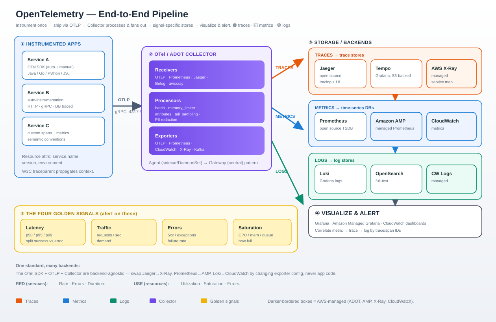
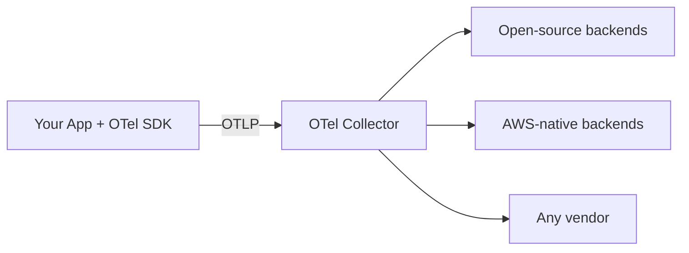
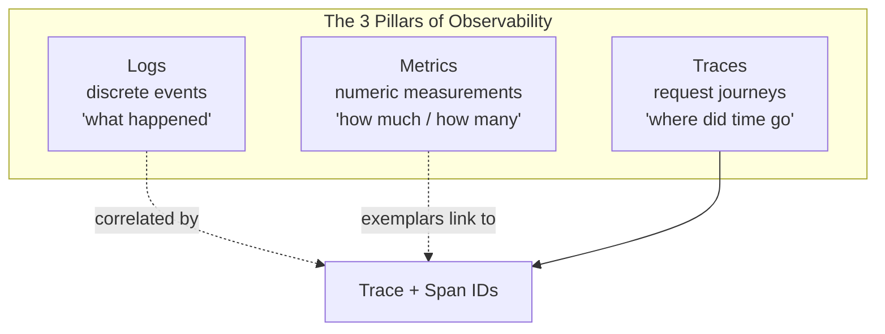
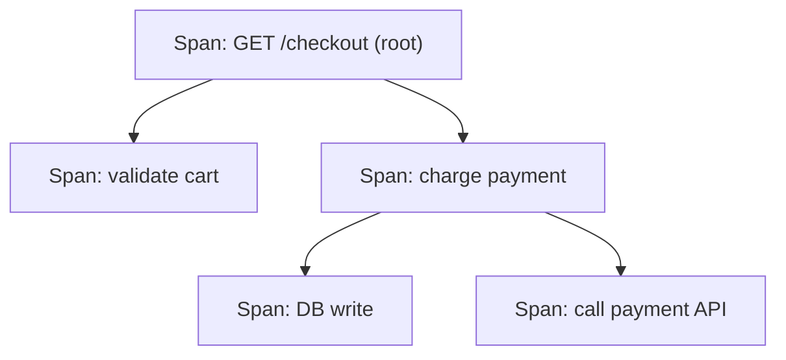
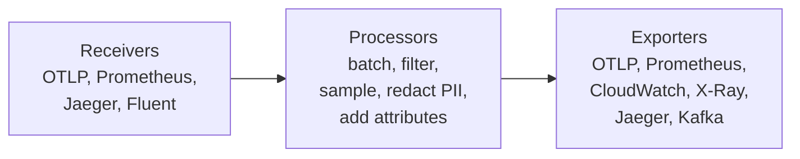
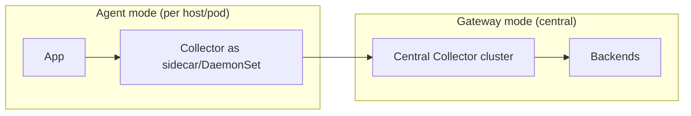
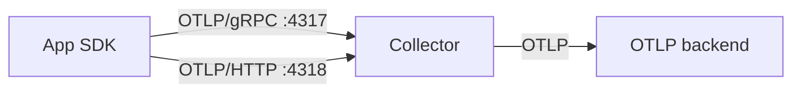
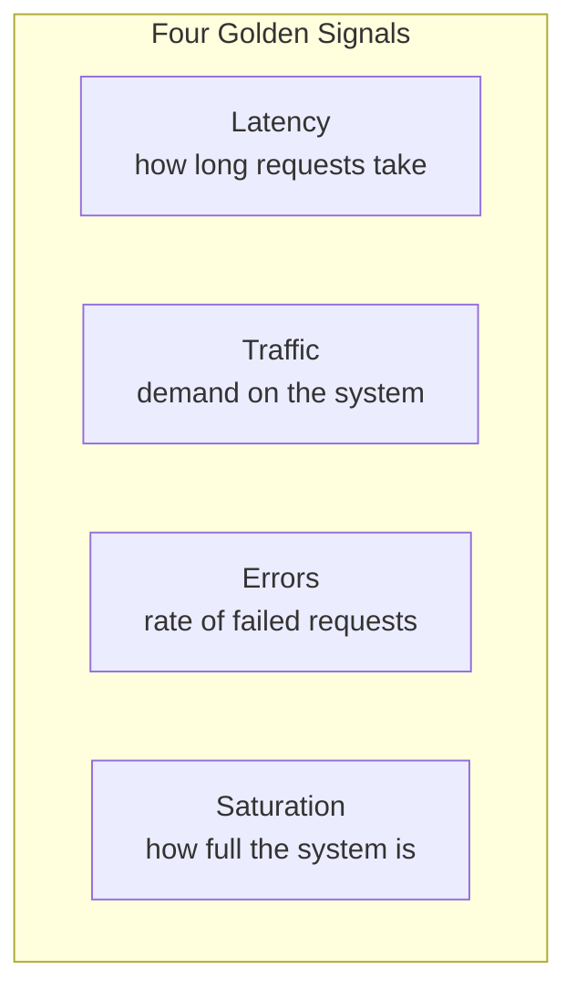
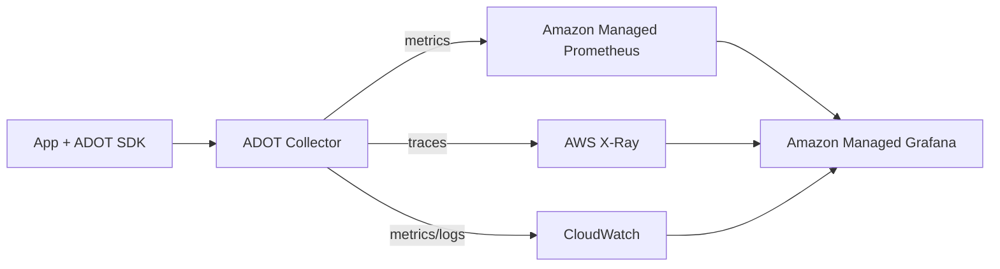
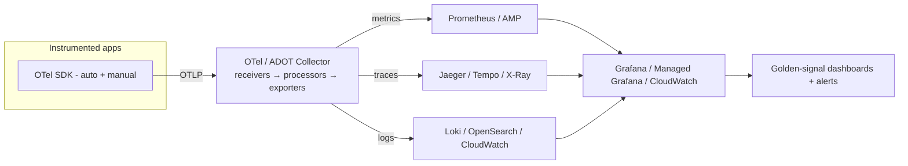

# OpenTelemetry (OTel) — The Complete Guide

> **In one sentence:** OpenTelemetry is a **vendor-neutral, open standard** for generating, collecting, and exporting the three signals of observability — **logs, metrics, and traces** — so you can instrument your code **once** and send that data to **any** backend (open source or AWS-native) without rewriting anything.

This guide covers the signals, the Collector, the OTLP protocol, storage, the golden signals, and both open-source and AWS-native components.

---

## Why OpenTelemetry exists

Before OTel, every vendor had its own agent and SDK. Switching from one observability tool to another meant re-instrumenting your entire codebase. OTel fixes that by being a **CNCF standard** (the second-most active CNCF project after Kubernetes):

- **Instrument once** — add the OTel SDK to your app once.
- **Export anywhere** — point it at Jaeger, Prometheus, Grafana, CloudWatch, X-Ray, Datadog… by changing config, not code.
- **No lock-in** — the data format (OTLP) and semantic conventions are open.

---

## 1. The three signals — Logs, Metrics, Traces

Observability rests on three complementary signal types. You need all three to fully understand a system.

| Signal | What it is | Answers | Example |
|--------|-----------|---------|---------|
| **Logs** | Timestamped, discrete event records (structured or text) | *What exactly happened?* | `ERROR order 123 payment declined` |
| **Metrics** | Numeric measurements aggregated over time | *How much? How many? How fast?* | `http_requests_total = 5,231`, `cpu = 72%` |
| **Traces** | The end-to-end path of a single request across services | *Where did the time/error go?* | request → API → auth → DB → cache |

### Traces in detail: spans and context

A **trace** is made of **spans** — each span is one unit of work (a function call, a DB query, an HTTP call). Spans nest to form a tree, tied together by a shared **trace ID**, and **context propagation** carries that ID across service boundaries so a request stays stitched together.

- **Span attributes** — key/value tags (`http.status_code=200`, `db.system=postgres`).
- **Span events** — timestamped moments within a span.
- **Context propagation** — trace/span IDs passed via headers (W3C `traceparent`) so the trace spans microservices.

### Correlation is the superpower

Because OTel attaches **trace and span IDs** to logs and links **exemplars** from metrics to traces, you can jump from *"latency spiked"* (metric) → *"this specific slow request"* (trace) → *"the exact error line"* (log). That cross-signal correlation is what makes OTel more than three separate tools.

---

## 2. The OpenTelemetry Collector

The **Collector** is a standalone service that **receives, processes, and exports** telemetry. It decouples your app from your backend — apps just send to the Collector, and the Collector handles the rest.

### Pipeline: receivers → processors → exporters

| Stage | Job | Examples |
|-------|-----|----------|
| **Receivers** | Ingest data in various formats | `otlp`, `prometheus`, `jaeger`, `filelog`, `awsxray` |
| **Processors** | Transform data in flight | `batch` (efficiency), `memory_limiter`, `attributes`, `tail_sampling`, PII redaction |
| **Exporters** | Send to one or more backends | `otlp`, `prometheusremotewrite`, `awscloudwatch`, `awsxray`, `logging` |

### Two deployment patterns

- **Agent** — a Collector runs close to the app (sidecar or node DaemonSet); low latency, local buffering.
- **Gateway** — a central Collector cluster does heavy processing, tail sampling, and fan-out to backends.
- **Common pattern:** agents feed a gateway. You can also skip the Collector and export straight from the SDK, but the Collector is recommended for production (buffering, retries, config changes without redeploys).

---

## 3. The protocol — OTLP

**OTLP (OpenTelemetry Protocol)** is the native wire format for all three signals. It's how SDKs talk to Collectors and Collectors talk to backends.

| Aspect | Detail |
|--------|--------|
| **Transports** | **gRPC** (port 4317) or **HTTP/protobuf** (port 4318) |
| **Encoding** | Protocol Buffers (compact, fast); JSON over HTTP also supported |
| **Signals** | One unified protocol carries logs, metrics, *and* traces |
| **Reliability** | Retries, backpressure, and batching built in |

Because OTLP is standardized, an OTel SDK can send to *any* OTLP-capable Collector or backend, and Collectors can forward on unchanged. This is the technical backbone of "no lock-in."

---

## 4. Storage — where telemetry lives

OTel itself **does not store data** — it generates and ships it. Storage is the job of a **backend**, and each signal typically goes to a store optimized for it:

| Signal | Storage characteristic | Common stores |
|--------|------------------------|---------------|
| **Metrics** | Time-series database (TSDB) | Prometheus, Amazon Managed Prometheus (AMP), Thanos, Cortex, Mimir |
| **Traces** | Trace store (high write, indexed by trace ID) | Jaeger, Grafana Tempo, AWS X-Ray |
| **Logs** | Log store (full-text / label indexed) | Grafana Loki, OpenSearch/Elasticsearch, CloudWatch Logs |

Key storage concerns:
- **Retention** — raw traces/logs are voluminous; keep recent data hot, roll older data to cheap object storage (e.g. S3-backed Tempo/Loki/Mimir).
- **Cardinality** — high-cardinality metric labels (like user IDs) explode TSDB cost; keep labels bounded.
- **Cost control** — **sampling** traces and aggregating metrics before storage are the main levers.

---

## 5. The Golden Signals

The **Four Golden Signals** (from Google's SRE book) are the metrics that matter most for user-facing systems. OTel metrics + traces make them easy to compute.

| Signal | Measures | Watch for |
|--------|----------|-----------|
| **Latency** | Time to serve a request (split success vs error!) | p50/p95/p99 rising |
| **Traffic** | Demand — requests/sec, transactions/sec | Spikes, drops |
| **Errors** | Rate of failed requests (5xx, exceptions) | Any sustained increase |
| **Saturation** | How "full" the most constrained resource is (CPU, memory, queue depth) | Approaching limits |

Two popular related frameworks:
- **RED** (for services) — **R**ate, **E**rrors, **D**uration.
- **USE** (for resources) — **U**tilization, **S**aturation, **E**rrors.

> **Practical tip:** alert on the golden signals (symptoms users feel), and use traces + logs to find the *cause* once an alert fires.

---

## 6. Open-source components

The OTel + CNCF ecosystem gives you a fully open observability stack:

| Component | Role |
|-----------|------|
| **OTel SDK / API** | Instrument your app (auto + manual) in Java, Go, Python, JS, .NET, etc. |
| **OTel Collector** | Receive → process → export telemetry |
| **OTel auto-instrumentation** | Zero/low-code agents (e.g. Java agent) that instrument popular libraries |
| **Prometheus** | Metrics TSDB + alerting |
| **Jaeger** | Distributed tracing backend + UI |
| **Grafana Tempo** | Scalable, object-storage-backed trace backend |
| **Grafana Loki** | Log aggregation (label-indexed, cheap) |
| **Grafana** | Dashboards + visualization across all three signals |
| **Mimir / Thanos / Cortex** | Long-term, scalable Prometheus storage |

A classic open-source stack: **OTel SDK → Collector → Prometheus (metrics) + Tempo (traces) + Loki (logs) → Grafana (view it all)**.

---

## 7. AWS-native components

On AWS, OTel plugs into managed services via **ADOT**, so you get the OTel standard with AWS-managed backends.

| Component | Role |
|-----------|------|
| **ADOT** (AWS Distro for OpenTelemetry) | AWS-supported build of the OTel SDK + Collector; EKS/ECS/Lambda add-on |
| **Amazon CloudWatch** | Metrics, Logs, dashboards, alarms — the AWS default |
| **Amazon Managed Service for Prometheus (AMP)** | Managed, scalable Prometheus-compatible metrics |
| **AWS X-Ray** | Managed distributed tracing + service map |
| **Amazon Managed Grafana (AMG)** | Managed Grafana dashboards over AMP / X-Ray / CloudWatch |
| **CloudWatch Application Signals** | APM-style golden-signal views built on OTel data |

> **Why ADOT:** you write standard OTel instrumentation (no lock-in), and AWS runs the pipeline and storage for you.

---

## 8. Other key OTel details

### Instrumentation: auto vs manual
- **Auto-instrumentation** — drop-in agents/libraries capture HTTP, gRPC, DB, and framework calls with little or no code change. Fastest way to get traces.
- **Manual instrumentation** — you create spans, add attributes, and record metrics in your own code for business-specific insight. Best combined with auto.

### Semantic conventions
OTel defines **standard names** for common attributes (`http.request.method`, `db.system`, `service.name`). Following them means dashboards, alerts, and backends understand your data out of the box — a huge part of OTel's value.

### Sampling (control cost & volume)
- **Head sampling** — decide at the start of a trace whether to keep it (simple, cheap, but blind to outcome).
- **Tail sampling** — decide *after* the trace completes (keep all errors and slow requests, drop boring ones). Done in the Collector's gateway; smarter but needs buffering.

### Context propagation
Trace context travels between services using the **W3C Trace Context** (`traceparent` header) standard, plus **baggage** for carrying custom key/values across the request path.

### Resource & attributes
Every signal is tagged with **resource attributes** (`service.name`, `service.version`, `deployment.environment`, host/k8s metadata) so you can slice telemetry by service, version, or environment.

---

## Putting it all together

**The mental model:** instrument once with the **SDK** → ship via **OTLP** → the **Collector** processes and fans out → signal-specific **stores** hold the data → **Grafana/CloudWatch** visualize → alert on the **golden signals**, drill into **traces** and **logs** for the cause.

---

## Resources

- [OpenTelemetry docs](https://opentelemetry.io/docs/) *(concepts rephrased for compliance)*
- [OTLP specification](https://opentelemetry.io/docs/specs/otlp/)
- [OTel Collector](https://opentelemetry.io/docs/collector/)
- [AWS Distro for OpenTelemetry (ADOT)](https://aws-otel.github.io/)
- [Google SRE — Golden Signals](https://sre.google/sre-book/monitoring-distributed-systems/)

*Educational overview; verify component names, ports, and behavior against current official docs before production use.*
